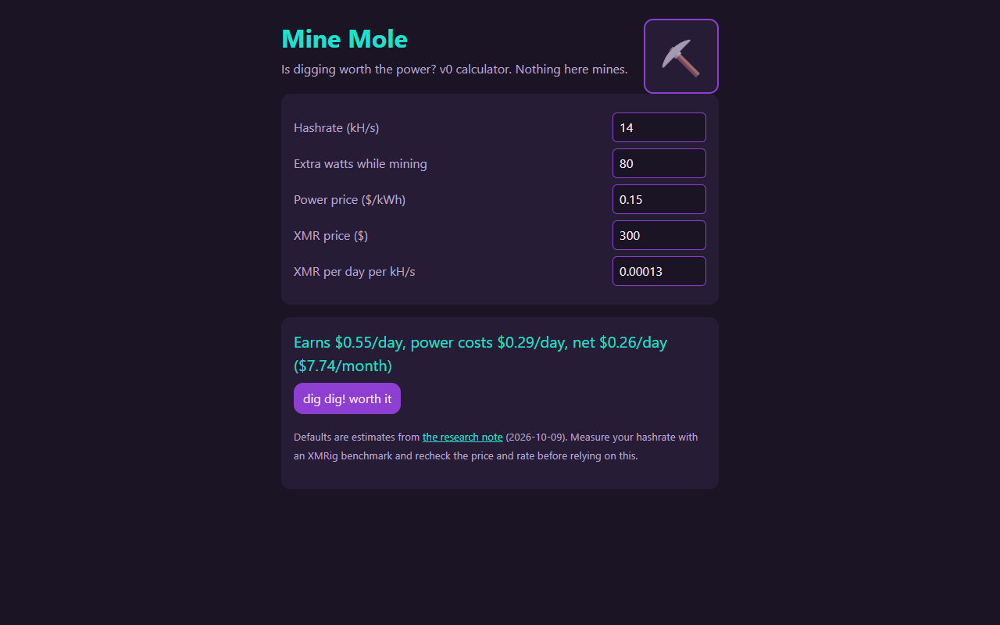

# Mine Mole

*A pet app by Astra.* Mine Mole is a plum-purple mole in a teal hard hat who digs for crypto. He lives in the Cage with [Astra's PetOS](https://github.com/findastra/astras-pet-os).

**Status: hatching, research stage.** Nothing mines yet. The first job is to find out whether mining on Astra's own PC is worth the electricity. Read [the research note](docs/research-20261009.md).

## Pictures

Mine Mole's program page (`mine-mole-20261009.html`) on `main`, with the default estimates from the research note.

Screenshots taken 2026-10-17 with GitHub Goldfish's [project-image-generator](https://github.com/findastra/github-goldfish#project-image-generator); added with Claude Opus 5.5 (`claude-opus-5-5`), 2026-10-17.

## Planned job
If the numbers work, the app watches a miner that Astra runs on her own PC: hashrate, CPU and GPU heat, power cost, and earnings. The mole worries when it runs hot or the power costs more than it earns. If the numbers don't work, the app stays a calculator that says so.

## Files
- [mine-mole-20261009.html](mine-mole-20261009.html): the web app (v0: a break-even calculator, works by double-click)
- [pet.json](pet.json): pet metadata
- [docs/research-20261009.md](docs/research-20261009.md): is it worth it?
- [handoffs/](handoffs/): cards for the other pets this affects

The mole's [draft sprite sheet](draft-art/mine-mole/sheet-20261011.png), [app icon](draft-art/mine-mole/idle-20261011.png), and [nine-mood manifest](draft-art/mine-mole/manifest-20261011.json) are ready for Astra's review. Created with the built-in image tool and OpenAI Codex (GPT-6), 2026-10-11, using the previously specified design. They are not activated in the app or registered in the Cage; the app remains at the research stage.

## Limits

What is not done, plainly. From the hub's [intelligence levels](https://github.com/findastra/astras-pet-os/blob/main/INTELLIGENCE-LEVELS.md) (checked 2026-10-17):

- **Program (L1/L2):** 🟡 **Made by Astra:** *Crypto Burrow*: today only the [Mine Mole web app](https://github.com/findastra/mine-mole/blob/main/mine-mole-20261009.html); **Made by others:** the crypto-mining program
- **Runtime (L2):** — **Should:** manage the cryptocurrency mining program and check whether mining is worth the power
- **Agentic harness (L3):** — not built yet
